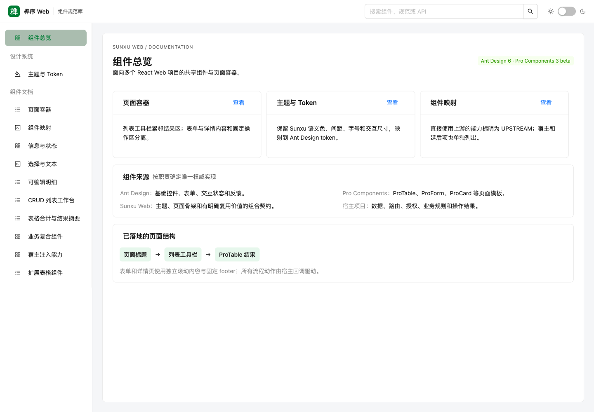
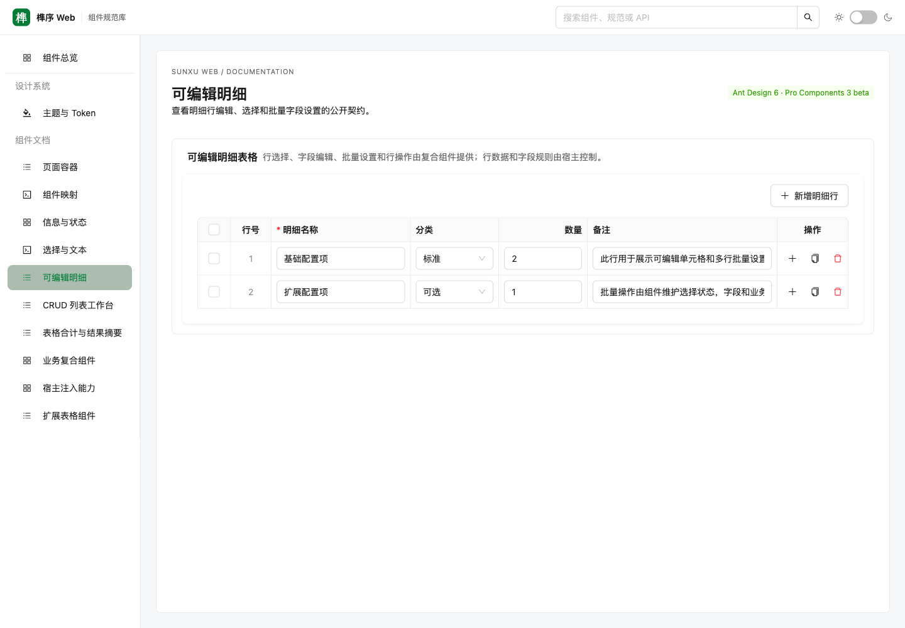
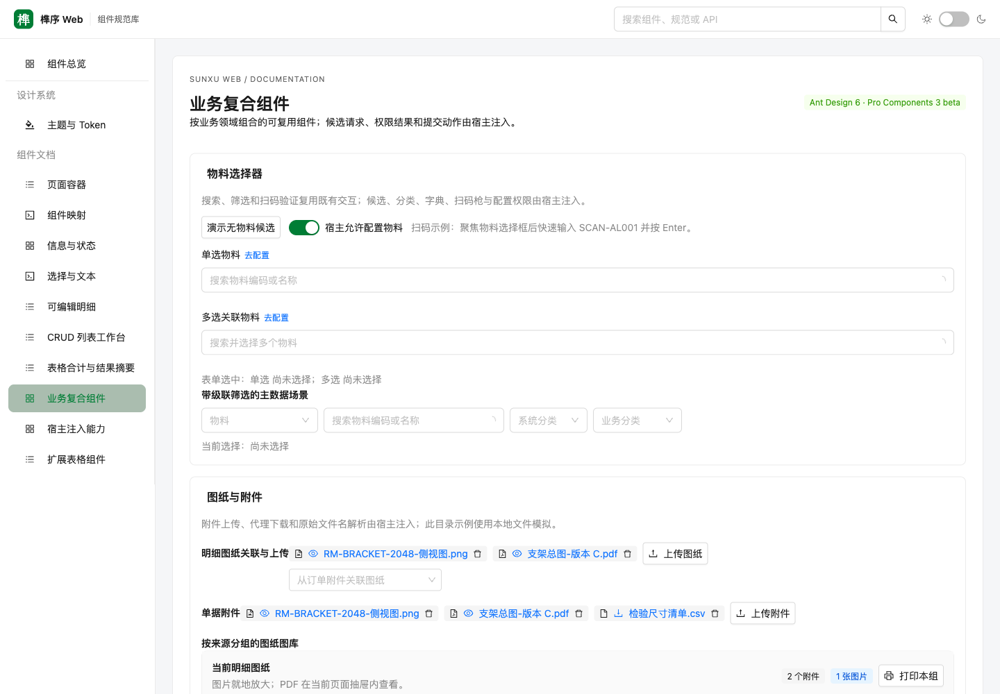
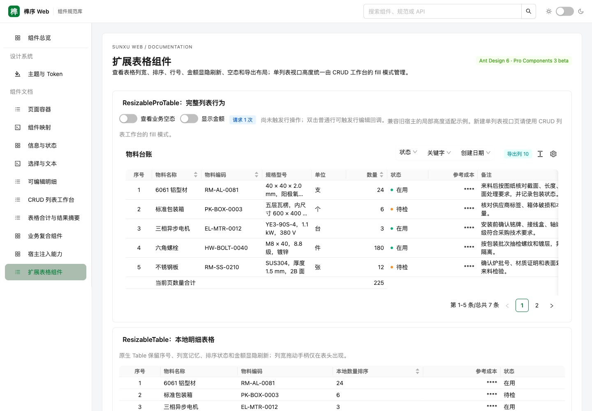
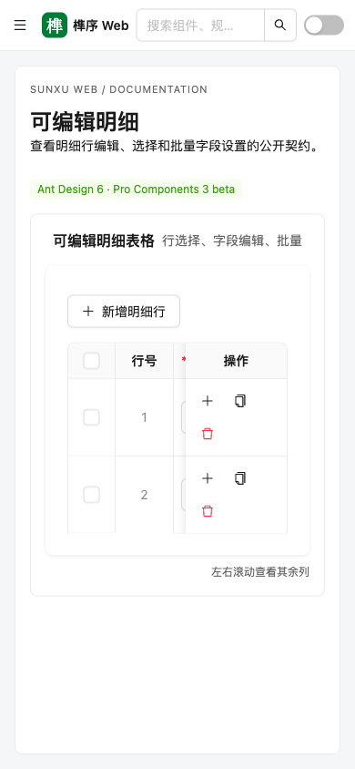

# 组件架构归一化目录渲染验收

## 环境与状态

- 目录预览：`http://127.0.0.1:4173/`，真实应用菜单导航到“组件总览”“可编辑明细”“业务复合组件”“扩展表格组件”。该目录使用 SPA 内部菜单状态，地址保持 `/`。
- 桌面视口：1440 × 1000；窄屏视口：390 × 844。
- 等待异步示例加载完成后采集截图与 DOM 几何，数据见同目录 [`geometry.json`](./geometry.json)。

## 几何结果

- 桌面四个状态的 `documentElement.scrollWidth/clientWidth` 均为 `1440/1440`，没有页面级横向溢出。
- 窄屏可编辑明细的 `scrollWidth/clientWidth` 为 `390/390`，没有页面级横向溢出；表格内部 `.ant-table-content.sxw-editable-detail-table__content` 为 `1028/241`，用于横向查看其余列。
- 桌面扩展表格的 `.ant-table-body` 为 `1592/1052`，溢出限制在表格结果区。
- 桌面目录头部高 56px、侧栏宽 224px；窄屏内容面距左侧 16px、宽 358px。

## 截图

## 控制台与验收边界

- 未观察到 `pageerror`。
- 扩展表格目录页出现一条 `use-antd-resizable-header` 控制台诊断：“请不要在所有列上添加 `width` 属性，这将导致表格无法自适应”。该页真实表格仍只在表格内横向滚动，根视口无溢出；宿主构建使用的依赖补丁识别组件的自适应内部列。该诊断记录为已知上游提示，未隐藏或过滤。
- 本次截图覆盖目录静态示例和本地数据；宿主真实 API、授权状态及各业务路由的实际渲染仍需宿主环境验收。
