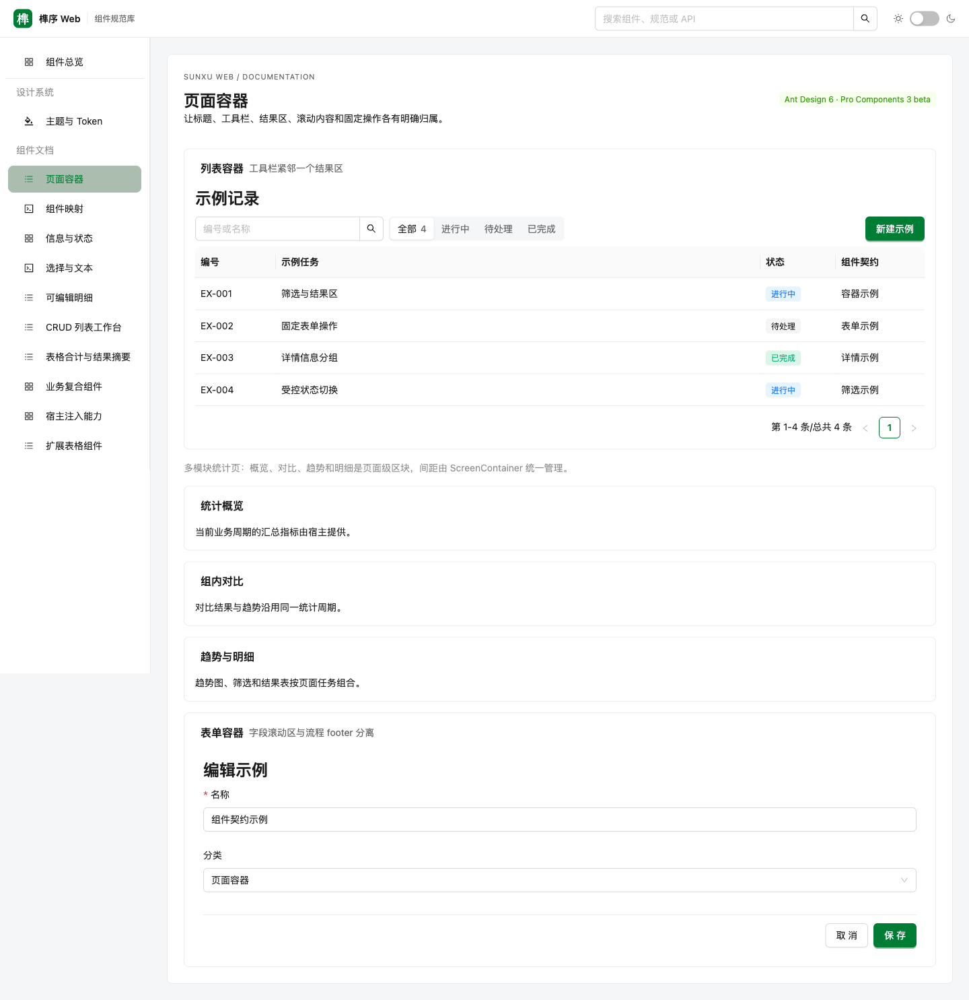
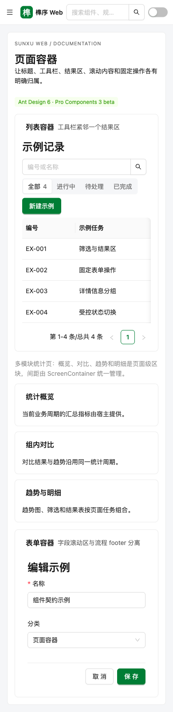

# 页面容器组合验收

## 目的

目录同时展示两种页面结构：ListScreenContainer 组织页头、紧邻工具栏和一个完整结果区；ScreenContainer 组织指标、对比、趋势和明细等多个页面级模块。此改动只澄清现有容器职责，没有新增运行时配置或组件 API。

## 渲染状态

- 目录路由：/，真实导航选择“页面容器”，默认浅色主题。
- 桌面视口：1440 × 1000 CSS px。
- 窄屏视口：390 × 844 CSS px。
- 桌面 ScreenContainer 直接子模块间距为 16px；窄屏为 12px。
- ListScreenContainer 根间距为 12px；其工具栏底部补偿后，工具栏到结果区的实测间距为 8px。
- 桌面 document 宽度为 1440/1440；窄屏为 390/390，没有页面级横向溢出。窄屏表格在结果区内部横向滚动，.ant-table-content 为 620/290px。
- 未观察到浏览器 console error 或 page error。文档页的纵向滚动是列表、容器和表单示例自然排列的结果。

## 截图

## 机器证据

- [DOM 几何](./geometry.json)
- [表面边界与间距 seam ledger](./spacing-audit.json)
- 页面根间距来源：src/styles.css 中 --sxw-page-gap；目录页面容器说明见 docs/component-contracts.md 与 docs/component-usage-policy.md。
